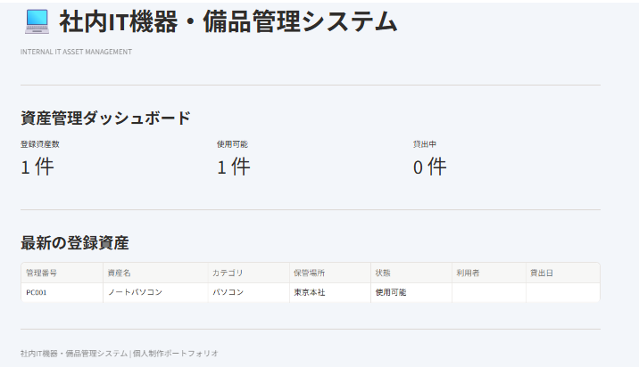
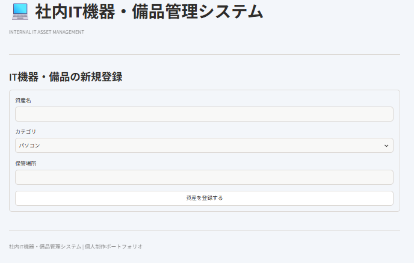
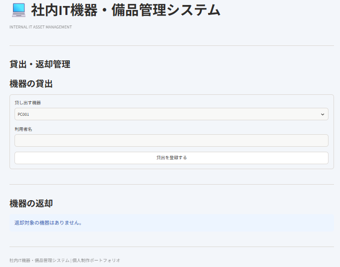
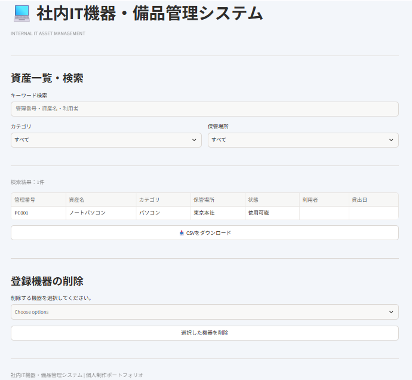

# 社内IT機器・備品管理システム

## 1. アプリの概要

社内で使用するパソコンや周辺機器などのIT資産を管理するためのWebアプリです。

機器の登録・貸出・返却・検索を一元管理し、備品管理業務の効率化を目的として制作しました。

## 2. 主な機能

- ダッシュボードによる登録資産数・貸出状況の確認
- IT機器・備品の新規登録
- 機器の貸出・返却管理
- 管理番号・資産名・利用者による検索
- カテゴリ・保管場所による絞り込み検索
- 登録機器の削除
- 資産一覧のCSVダウンロード

## 3. 使用技術

- Python
- Streamlit
- CSV

## 4. アプリの起動方法

### ① 必要なライブラリをインストール

```bash
pip install streamlit
```

### ② アプリを起動

```bash
streamlit run app.py
```

### ③ ブラウザで表示

起動後、ブラウザに表示されるURLからアプリを利用できます。

## 5. データ管理

登録した機器情報はCSVファイルに保存されます。

ファイル名：assets_app.csv

アプリを再起動しても登録データを保持できます。

## 6. 制作目的

Pythonの基礎学習を通じて、変数・条件分岐・繰り返し・リスト・辞書・関数などの知識を活用し、実際の業務を想定した管理アプリの制作に取り組みました。

特に、IT機器の資産管理や貸出状況の把握、検索業務の効率化を意識して設計しました。


## 7. 画面イメージ

### ダッシュボード


### 機器登録


### 貸出・返却


### 資産一覧・検索

